<p align="center">
  <picture>
    <source media="(prefers-color-scheme: dark)" srcset="resources/branding/arcanblade-mark-256.png">
    
  </picture>
</p>

<h1 align="center">Arcanblade (Windows / 手机网页)</h1>

<p align="center">
  <strong>管理音声作品与字幕，AI识别音频并生成中文字幕。</strong>
</p>

<p align="center">
  面向 Windows 的 ASMR 音声管理工具与播放器，支持字幕自动匹配和同步显示。<br>
  可离线生成中文字幕，也可先识别日文，再结合<strong>作品级上下文</strong>润色与翻译。
</p>

<p align="center">
  <a href="https://github.com/leiding555/AsmrPlayer-Arcanblade/releases/tag/v0.1.3"></a>
  
  <a href="LICENSE"></a>
</p>

<p align="center">
  <a href="#主要功能">主要功能</a> ·
  <a href="#使用说明">使用说明</a> ·
  <a href="#翻译效果对比">翻译效果对比</a> ·
  <a href="#常见问题">常见问题</a> ·
  <a href="#界面展示">界面展示</a> ·
  <a href="#许可证与致谢">许可证与致谢</a>
</p>

<p align="center">
  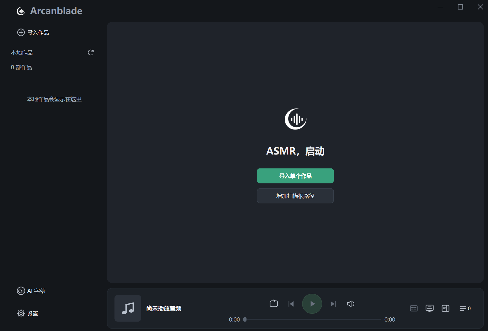
</p>

## 主要功能

- **音声作品管理**：导入本地作品，按作品与目录浏览、播放音轨，自动保存播放进度。
- **同步字幕**：支持 SRT、VTT、LRC，自动匹配本地字幕，可在侧栏或桌面浮窗同步显示。
- **手机播放**：手机浏览器可浏览作品、在线播放并查看同步字幕，也可跨作品选择音轨，一次导出到手机离线库。
- **离线直译**：日语音频直接生成中文字幕，组件安装后完全离线运行。
- **作品级上下文润色与翻译**：先在本机识别日文字幕，再由大语言模型参考作品资料或同作品识别结果，润色校正日文并翻译为中文。

两种 AI 字幕方式，可按需求选择：

| 方式 | 流程 | 侧重点 |
| --- | --- | --- |
| 离线直译 | 日语音频 → 中文字幕 | 方便、完全离线 |
| 识别后翻译 | 日语音频 → 日文字幕 → 作品级上下文润色与翻译 → 中文字幕 | 作品级上下文、译文质量 |

引擎和模型不随播放器发行包附带，首次使用需联网下载。离线直译、日语识别均在本机运行；字幕翻译需自行配置 API 服务。

## 使用说明

### 一、作品导入与播放

- **导入作品**：点击 **导入作品 → 导入单个作品…** 选择作品目录。批量管理可选 **添加扫描根目录…**：软件会将该目录下的**每个直属子文件夹视为独立作品**，分别导入其中的音频与字幕；没有受支持音频的文件夹会跳过。
- **字幕自动绑定**：支持 SRT、VTT、LRC，在同一作品目录内按名称匹配音频，**字幕与音频可以放在不同子文件夹中**。需要调整时，点击播放栏的 **选择或管理字幕**。
- **批量生成字幕**：在作品音轨列表点击 **批量**，勾选当前目录的多首音轨，再通过 **添加 → 离线直译／日语识别** 批量加入任务。
- **进入播放详情**：双击音轨开始播放，点击底部播放栏的**封面图片**即可展开播放详情页。当前支持 MP3、WAV 音频。
- **点击字幕跳转**：播放详情页和侧边字幕中的文字均可点击，直接跳转到对应的音频位置。
- **手机播放**：参见下方的[手机播放与离线库](#二手机播放与离线库)。

### 二、手机播放与离线库

在 Windows 端打开 **设置 → 手机播放**，即可用手机浏览器播放电脑上的音声和同步字幕。局域网播放期间，电脑需要保持 Arcanblade 运行并开启共享。音轨导入手机离线库后，即使电脑关机、手机断网，也能播放已导入的内容。

<details>
<summary><strong>1. 设置 Windows 专用网络和防火墙</strong>（点击展开 / 收起）</summary>

1. **让电脑和手机连接同一局域网。** 两台设备可以连接同一个家庭 Wi‑Fi，电脑也可以通过网线连接到同一路由器。
2. **将电脑当前连接的家庭网络设为「专用网络」。** 打开 Windows **设置 → 网络和 Internet**，进入当前连接的 **WLAN（Wi‑Fi）** 或 **以太网** 属性，在 **网络配置文件类型** 中选择 **专用网络**。仅对自己信任的网络使用此设置。 [微软网络设置说明](https://support.microsoft.com/en-us/windows/experience/connectivity-networking/essential-network-settings-and-tasks-in-windows)

   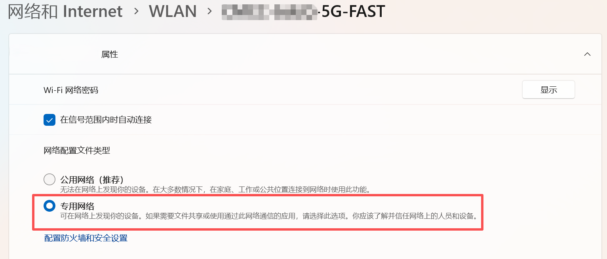

3. **允许 Arcanblade 通过专用网络防火墙。** 首次点击 **开启共享** 时，如果 Windows 弹出提示，只勾选 **专用网络**，然后点击 **允许**。如果此前点过取消，可打开 **Windows 安全中心 → 防火墙和网络保护 → 允许应用通过防火墙 → 更改设置**，为 Arcanblade 勾选 **专用**。如果列表里没有 Arcanblade，点 **允许其他应用…**，选择当前使用的 `Arcanblade.exe`。 [微软防火墙说明](https://support.microsoft.com/en-us/windows/security/windows-security/firewall-and-network-protection-in-the-windows-security-app)

   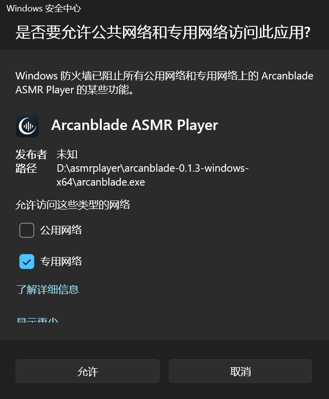

</details>

<details>
<summary><strong>2. 用手机扫码配对</strong>（点击展开 / 收起）</summary>

1. 在电脑端打开 **设置 → 手机播放**，在 **网络接口** 中选择手机所在局域网对应的 **WLAN** 或 **以太网**，点击 **开启共享**。
2. 用手机相机扫描电脑上的二维码，在手机浏览器打开链接。扫码链接会自动配对。如果在微信或 QQ 内打开后看到提示，请把完整链接复制到手机浏览器打开。
3. 也可以手动配对。在手机浏览器输入电脑窗口显示的 **浏览器地址**，再输入六位 **配对码**，点击 **连接**。二维码和六位码共用一次配对机会，**5 分钟内有效**。用过或过期后，在电脑端点 **换新码**。

   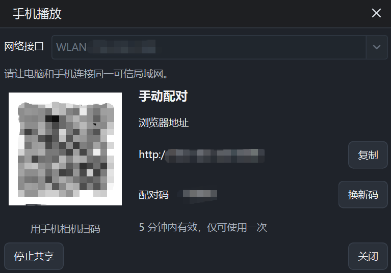

4. 配对成功后，手机会显示 **作品库**。点开作品并选择一条音轨，即可播放。当前字幕随播放高亮，点击字幕可跳到对应位置。

   
   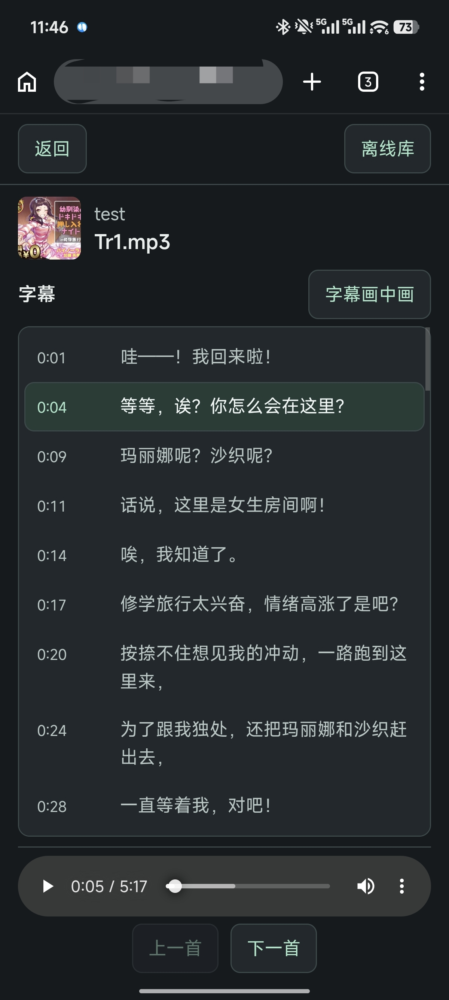

如果扫码后网页打不开，先确认电脑仍在共享、网络接口选对了，并检查 Windows 的专用网络及防火墙设置。若手机连的是访客 Wi‑Fi，可换到家里的主 Wi‑Fi 再试。

</details>

<details>
<summary><strong>3. 导出到手机离线库</strong>（点击展开 / 收起）</summary>

1. 在手机的局域网 **作品库** 点击 **导出到离线库**。
2. 勾选整部作品，或点击 **展开** 后只勾选需要的音轨。一次可以选择多部作品。

   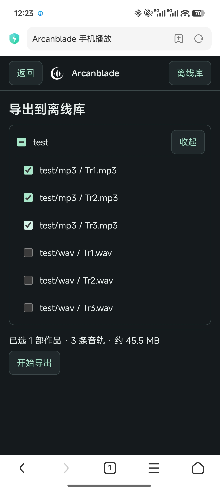

3. 点击 **开始导出**。浏览器会打开一个离线库页面，按作品顺序传输和导入所选音轨、对应字幕及封面。导出期间，请保留两个网页并保持电脑共享开启。
4. 等页面显示导入成功，再在 **离线库** 打开作品试听。确认完成后，可以停止电脑共享。

   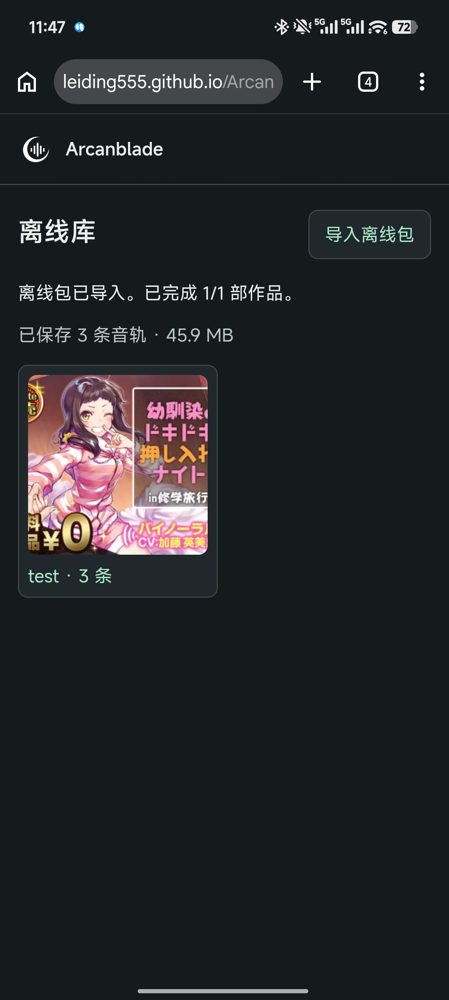

如果自动导出失败，可在局域网网页打开作品详情，点击 **下载离线包**，选好音轨后点击 **下载压缩包**。下载完成后，打开 [Arcanblade 离线库](https://leiding555.github.io/Arcanblade-offline/)，点击 **导入离线包**，选择刚下载的 ZIP。确认导入和播放正常后，可以删除下载目录中的 ZIP。

</details>

<details>
<summary><strong>4. 把离线库添加到手机桌面</strong>（点击展开 / 收起）</summary>

先在局域网作品库右上角点 **离线库**，或用手机浏览器联网打开一次 [Arcanblade 离线库](https://leiding555.github.io/Arcanblade-offline/)，等待页面加载完成。

**推荐把离线库网址加入浏览器书签。** 页面缓存完成后，即使手机断网，也可以在同一个浏览器里从书签或地址栏打开离线库，播放已导入的音轨并查看字幕。

如果更习惯从手机桌面打开，也可以在离线库页面添加桌面图标。

- **Android（Chrome）**。点浏览器右上角 **⋮ → 安装并创建快捷方式**，按提示完成。不同版本也可能显示 **添加到主屏幕** 或 **安装应用**。 [Chrome 使用说明](https://support.google.com/chrome/answer/9658361?co=GENIE.Platform%3DAndroid&hl=zh-Hans)

  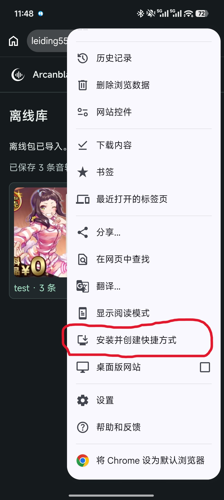

- **iPhone（Safari）**。点 **分享 → 添加到主屏幕**。如果显示 **作为网页 App 打开**，开启后点 **添加**。 [Safari 使用说明](https://support.apple.com/zh-cn/guide/iphone/open-as-web-app-iphea86e5236/ios)

添加后，从桌面图标打开离线库，确认已导入的作品可见。可开启飞行模式，试听一条音轨并检查字幕。如果桌面入口看不到作品，用原来导入时的浏览器标签页检查。不同浏览器或不同入口可能使用独立的站点存储。

</details>

### 三、AI 字幕

<details>
<summary><strong>1. 离线直译：音频直接生成中文字幕</strong>（点击展开 / 收起）</summary>

1. 打开 **AI 字幕**，将 **生成方式** 设为 **离线直译**，进入 **组件与设置 → 安装组件**，选择下载安装位置，点击 **下载并准备**。如果已有完整组件，可通过 **选择已有组件…** 指定包含 `infer.exe` 的已解压目录。
2. **使用 GPU 加速需下载匹配的组件版本**：按显卡与驱动选择 NVIDIA CUDA 或对应 AMD 架构版本，可使用软件的自动推荐。随后将 **运行方式** 设为 **GPU（低显存）** 或 **GPU（高显存）**；没有合适 GPU 时可选择 **CPU**。显卡、显存与版本要求见 [上游硬件与版本说明](https://github.com/TransWithAI/Faster-Whisper-TransWithAI-ChickenRice/blob/v1.10/README.md)。
3. 返回任务页，通过 **添加音频…** 或作品库的批量操作加入音频，点击 **开始生成**。支持批量任务，组件准备完成后无需联网。

<p align="center">
  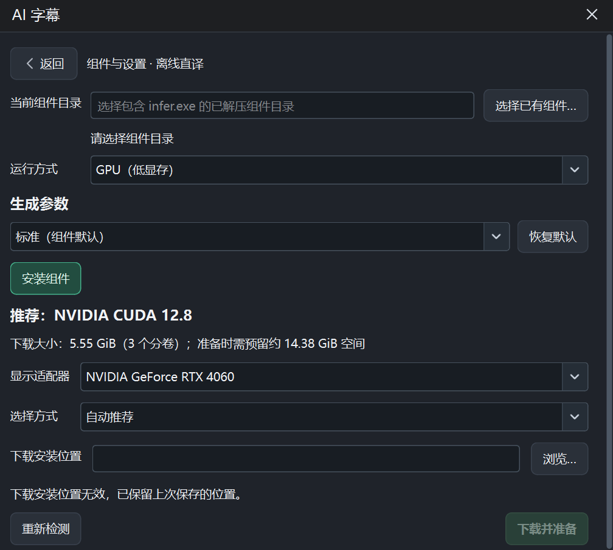
</p>

</details>

<details>
<summary><strong>2. 日语识别：先生成日文字幕</strong>（点击展开 / 收起）</summary>

1. 将 **生成方式** 切换为 **日语识别**，进入 **组件与设置 → 安装组件**，设置安装位置后点击 **下载并准备**，软件会准备识别引擎和模型。已有完整组件时，可通过 **选择已有组件…** 指定包含 `faster-whisper-xxl.exe` 的目录。
2. 根据硬件选择 **GPU（低显存）／GPU（高显存）／CPU**。此流程的 GPU 加速使用 NVIDIA CUDA，组件说明见 [Faster-Whisper-XXL](https://github.com/Purfview/whisper-standalone-win)，硬件与运行环境可参考 [Faster Whisper 配置说明](https://github.com/SYSTRAN/faster-whisper#requirements)。
3. 添加音频并点击 **开始生成**，支持批量任务。成功生成的日文字幕会**自动加入字幕翻译列表**；点击 **前往字幕翻译** 即可继续配置并启动翻译。

<p align="center">
  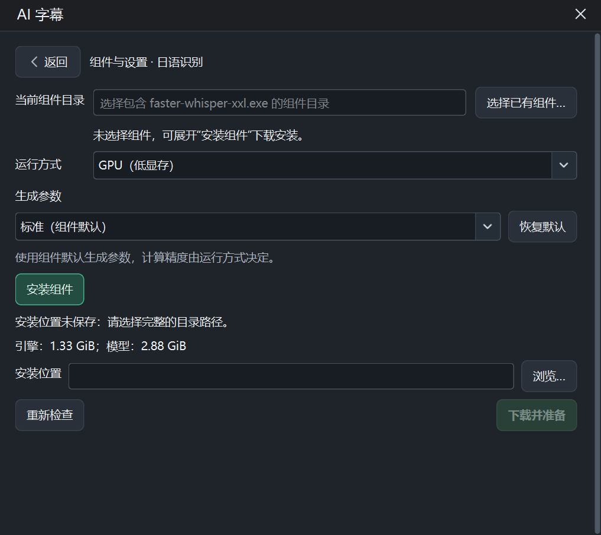
</p>

</details>

<details>
<summary><strong>3. 字幕翻译：DeepSeek 润色与翻译</strong>（点击展开 / 收起）</summary>

1. 在 [DeepSeek 开放平台](https://platform.deepseek.com/api_keys) 创建 API Key，接口说明见 [DeepSeek API 文档](https://api-docs.deepseek.com/zh-cn/)。
2. 切换到 **字幕翻译 → 翻译设置**，服务选择 **DeepSeek**，选择模型，填写 API Key 并点击 **保存 Key**，可通过 **测试连接** 检查配置。
3. 返回任务页，使用日语识别自动加入的字幕，或点击 **添加字幕…** 导入字幕；可按需勾选下列选项，再点击 **开始翻译**，支持批量任务。

<p align="center">
  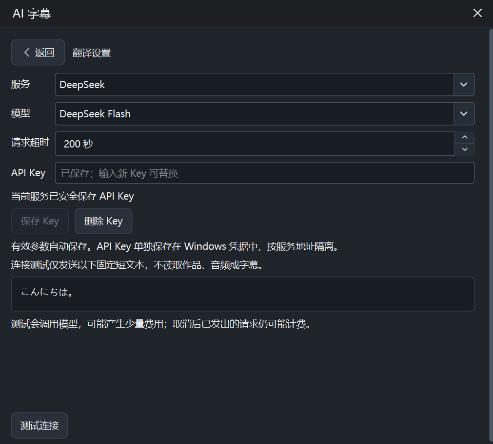
</p>

- **启用思考模式**：让模型先进行推理再输出，处理时间与用量可能增加。
- **使用作品上下文**：参考作品目录内已扫描的文本、Markdown、PDF 等资料构建作品上下文；没有可用正文时，参考同作品的日语识别结果，先校正日文，再翻译为中文。**目前仅支持 DeepSeek，以及本软件生成并已入库、原音轨仍在库中的日语识别字幕**；仅手动添加外部字幕无法使用此模式。该选项对整批任务生效，会增加 token 用量与费用。
- **自动绑定与使用**：作品库中的音轨翻译完成后，中文字幕会自动关联到原音轨；默认自动模式下使用最新生成的字幕。若曾手动指定默认字幕或选择不使用字幕，可在字幕管理中点击 **恢复默认**，恢复自动选择。

API 翻译会将字幕及启用的作品上下文发送给所选服务，请自行确认需要发送的内容。

</details>

## 翻译效果对比

以下为同一音频约 **11:49–12:26** 的实际输出。右侧使用日语识别后由 **DeepSeek Flash** 翻译，开启了**作品上下文与思考模式**。保留输出原文，仅合并展示相邻字幕；两种方式的断句与时间轴略有不同，单个片段仅供参考。

| 时间段（约） | 离线直译 | 日语识别＋字幕翻译（上下文＋思考） |
| --- | --- | --- |
| 11:49–12:00 | 对 对不起 我的头发很痒吧<br>下次给你掏耳朵的时候我会好好地睡一觉的 | 啊，对不起。是我的头发弄痒您了吧。下次掏耳朵的时候我会把头发扎起来的。 |
| 12:00–12:15 | 没错 头发变得挺长了对吧<br>因为前辈你说柚希的头发很漂亮嘛 | 是啊。长了不少吧。因为学长说过柚木的头发很漂亮嘛。 |
| 12:16–12:26 | 从中学开始就没有剪过<br>那之后这头发一直都是我最自豪的 | 从初中起就没剪过哦。从那以后，这头发一直是我最大的骄傲。 |

## 常见问题

<details>
<summary><strong>配对的浏览器网址打不开怎么办？</strong>（点击展开 / 收起）</summary>

先确认手机和电脑连在同一个可信局域网，且电脑端已开启共享。然后在 Windows 的 **设置 → 网络和 Internet** 中打开当前网络的属性，将网络配置文件设为 **专用网络**。接着确认 Windows 防火墙已允许 `Arcanblade.exe` 通过 **专用网络**。这两处分别设置，完成后再用「手机播放」窗口显示的地址或二维码连接。[Windows 网络设置说明](https://support.microsoft.com/en-us/windows/experience/connectivity-networking/essential-network-settings-and-tasks-in-windows)

</details>

<details>
<summary><strong>「导出到离线库」报错，或点「下载离线包」后没有开始下载怎么办？</strong>（点击展开 / 收起）</summary>

部分手机自带浏览器可能在跨页面导入或下载 ZIP 时遇到兼容问题。建议用 **Chrome 或夸克浏览器**打开电脑端显示的配对地址，重新配对后再试。如果能下载 ZIP，可以改用离线库的 **导入离线包** 手动导入。

</details>

<details>
<summary><strong>从手机桌面打开离线库，点「导入离线包」没反应怎么办？</strong>（点击展开 / 收起）</summary>

部分手机从桌面快捷方式打开离线库时，文件选择器无法弹出，目前尚未解决。请用**创建该快捷方式的同一个浏览器**，在普通标签页打开离线库并导入 ZIP。导入后可从桌面图标检查作品是否可见。如果该入口没有显示作品，就在原浏览器标签页播放。[打开 Arcanblade 离线库](https://leiding555.github.io/Arcanblade-offline/)

</details>

<details>
<summary><strong>「字幕画中画」按钮是灰的，点不了怎么办？</strong>（点击展开 / 收起）</summary>

**目前仅在 Chrome 中验证可用**。请用手机上的 Chrome 普通标签页打开播放页，并选择一条带字幕的音轨。如果按钮仍是灰色，说明当前打开方式未提供该功能所需的浏览器接口，仍可在播放页查看同步字幕。

</details>

<details>
<summary><strong>模型安装很慢、卡住或失败怎么办？</strong>（点击展开 / 收起）</summary>

软件从 GitHub 下载引擎组件，日语识别的 large-v2 模型从 Hugging Face 下载。网络不通或不稳定时，请 **以管理员身份运行代理软件（梯子）**，并 **开启全局代理/Tun/虚拟网卡模式** 后重试。如果仍无法下载，可以从上游手动下载，完整解压后在软件中设置组件路径：

1. **离线直译**：[ChickenRice v1.10 下载页](https://github.com/TransWithAI/Faster-Whisper-TransWithAI-ChickenRice/releases/tag/v1.10)。选择适合显卡的 **translate 翻译版**，下载同一版本的全部分卷，合并为 ZIP 后完整解压，保留原有模型及依赖目录。在软件中选择包含 `infer.exe` 的目录。
2. **日语识别**：[Faster-Whisper-XXL 下载页](https://github.com/Purfview/whisper-standalone-win/releases/tag/Faster-Whisper-XXL)。下载并完整解压 **`Faster-Whisper-XXL_r245.4_windows.7z`**，另外下载 [large-v2 模型（与软件匹配的版本）](https://huggingface.co/Systran/faster-whisper-large-v2/tree/f0fe81560cb8b68660e564f55dd99207059c092e) 的四个完整文件，放入组件目录下的 **`_models/faster-whisper-large-v2/`**（`_models` 带下划线）：

```text
组件目录/
├─ faster-whisper-xxl.exe
└─ _models/
   └─ faster-whisper-large-v2/
      ├─ config.json
      ├─ model.bin
      ├─ tokenizer.json
      └─ vocabulary.txt
```

完成后，进入对应生成方式的 **组件与设置 → 选择已有组件…**，选择包含对应 EXE 的组件目录。日语识别可点击 **重新检查**，确认引擎和模型均已就绪后再开始任务。

</details>

## 界面展示

**作品库与同步字幕**

<p align="center">
  
</p>

**播放详情**

<p align="center">
  
</p>

## 许可证与致谢

本项目原创代码及原创图标采用 [MIT License](LICENSE)。第三方引擎、模型和运行时依赖适用各自的许可证，来源与许可说明见 [NOTICE](NOTICE)。

感谢 Qt、TransWithAI、Purfview、SYSTRAN 及相关模型作者。
